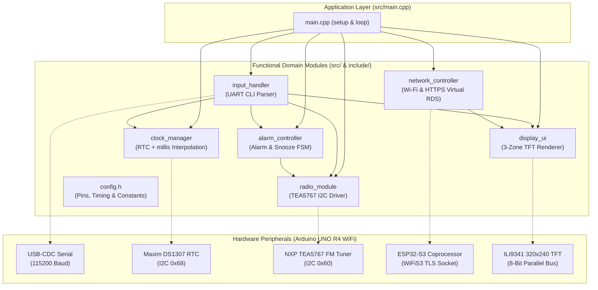
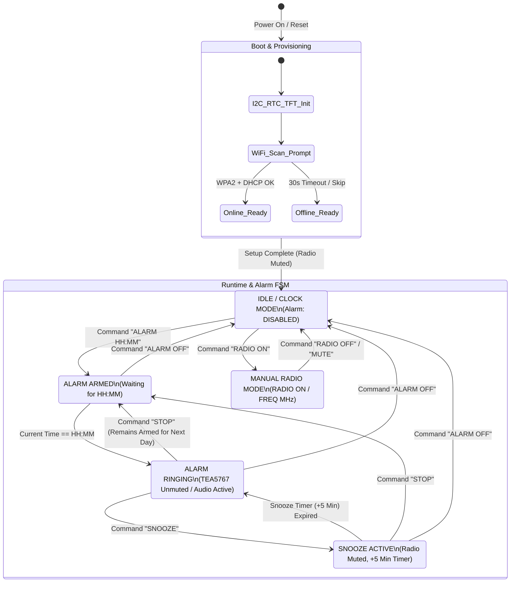

# Multifunctional FM Radio Alarm Clock with Virtual RDS

[]()
[]()
[]()
[]()
[]()
[](LICENSE)

An embedded C++17 firmware architecture for a **Multifunctional FM Radio Alarm Clock** featuring cloud-assisted **Live Virtual RDS**, built for the **Arduino UNO R4 WiFi** (Renesas RA4M1 ARM Cortex-M4 + onboard ESP32-S3 coprocessor). The system integrates an analog FM stereo receiver (`TEA5767`), a battery-backed real-time clock (`DS1307`), an 8-bit parallel 320×240 color TFT display (`ILI9341`), and an HTTPS/JSONP client that fetches real-time "Now Playing" artist and track metadata over Wi-Fi.

---

## Table of Contents
1. [Overview & Key Features](#1-overview--key-features)
2. [System Architecture & State Machine (Mermaid Diagrams)](#2-system-architecture--state-machine-mermaid-diagrams)
3. [Hardware & Pinout Table](#3-hardware--pinout-table)
4. [Repository Structure](#4-repository-structure)
5. [Build & Flash Instructions](#5-build--flash-instructions)
6. [Serial CLI Command Reference](#6-serial-cli-command-reference)

---

## 1. Overview & Key Features

- **Drift-Free Real-Time Clock with I2C Audio Isolation (`ClockManager`):**
  - Combines the battery-backed hardware RTC (`Maxim DS1307`) with `millis()` delta time interpolation.
  - Eliminates the 1 Hz I2C bus crosstalk ("audio popping") on the shared `TEA5767` analog audio stage by querying the physical I2C RTC only once per hour while maintaining exact second-by-second accuracy—even across multi-second blocking TLS handshakes.
- **Finite State Machine Alarm & Snooze Controller (`AlarmController`):**
  - Deterministic 4-state alarm state machine (`DISABLED`, `ARMED`, `RINGING`, `SNOOZED`).
  - Supports daily auto-rearming, manual alarm dismissal (`STOP`), full deactivation (`ALARM OFF`), and a **5-minute snooze timer (`SNOOZE`)**.
- **FM Stereo Tuner Driver (`RadioTEA5767`):**
  - Direct 5-byte I2C register control (`0x60`) implementing rounded 14-bit high-side injection PLL synthesis, FM broadcast band clamping (`87.5–108.0 MHz`), High Cut Control (`HCC`), Stereo Noise Cancelling (`SNC`), and hardware mute.
- **Live Virtual RDS over HTTPS (`NetworkController`):**
  - Dynamic Wi-Fi network scanner and interactive WPA2 provisioning on boot (with an automatic 30-second offline fallback).
  - Polls live station metadata (`core-search.radioplayer.cloud`) every 15 seconds over TLS (`WiFiSSLClient` on the ESP32-S3) and parses the JSONP stream in-place using `ArduinoJson` v7 filter projection to stay well within the RA4M1's 32 KB SRAM budget.
- **Flicker-Free 3-Zone TFT User Interface (`DisplayUI`):**
  - Drives a 320×240 `ILI9341` color TFT over an 8-bit parallel data bus (`Arduino_SWPAR8`).
  - Strictly partitioned viewports for the **Header Banner** (station name, tuned frequency, mute indicator), **Now Playing Body** (Artist & Song with change-detection caching), and **Clock/Alarm Footer** (flicker-free 1 Hz opaque glyph rendering).
- **Non-Blocking USB-Serial CLI (`InputHandler`):**
  - Runtime command parser with strict numeric validation and line-overflow protection.

---

## 2. System Architecture & State Machine (Mermaid Diagrams)

### 2.1 Modular Software Architecture



### 2.2 Device & Alarm State Machine



---

## 3. Hardware & Pinout Table

| Component | Pin / Bus | Function | Notes |
| :--- | :--- | :--- | :--- |
| **ILI9341 TFT Display** | `A0` (`LCD_RD`) | 8-Bit Parallel Read Strobe | Active Low |
| **ILI9341 TFT Display** | `A1` (`LCD_WR`) | 8-Bit Parallel Write Strobe | Active Low |
| **ILI9341 TFT Display** | `A2` (`LCD_RS` / `DC`) | Data / Command Select | Register Select |
| **ILI9341 TFT Display** | `A3` (`LCD_CS`) | Chip Select | Active Low |
| **ILI9341 TFT Display** | `D10` (`LCD_RST`) | Hardware Reset | Active Low |
| **ILI9341 TFT Display** | `D8`, `D9`, `D2`–`D7` | 8-Bit Parallel Data (`D0`–`D7`) | `Arduino_SWPAR8` data bus |
| **TEA5767 FM Radio** | `A4` (`SDA`), `A5` (`SCL`) | Primary I2C Bus (`Wire`, `0x60`) | FM stereo tuner (87.5–108.0 MHz) |
| **DS1307 RTC Module** | `A4` (`SDA`), `A5` (`SCL`) | Primary I2C Bus (`Wire`, `0x68`) | Real-time clock with CR2032 backup |
| **ESP32-S3 Wi-Fi** | Internal UART Bridge | `WiFiS3` Network Coprocessor | HTTPS/TLS 1.2+ socket offload |
| **Serial Terminal** | `USB-C` (`D0`/`D1`) | `Serial` @ `115200` Baud | Set line ending to `Newline (LF)` |

---

## 4. Repository Structure

```text
multifunktionaler-radiowecker/
├── docs/
│   ├── ARCHITECTURE.md          # Detailed system architecture & hardware pinout reference
│   └── CODE_AUDIT.md            # Technical feasibility audit & bug resolution report
├── include/
│   ├── alarm_controller.h       # Daily alarm & snooze finite state machine interface
│   ├── clock_manager.h          # DS1307 RTC driver wrapper & drift-free time interpolation
│   ├── config.h                 # Central hardware pins, timing, network & UI constants
│   ├── display_ui.h             # 3-zone ILI9341 TFT graphical user interface declarations
│   ├── input_handler.h          # Non-blocking Serial CLI parser & command dispatcher
│   ├── network_controller.h     # Dynamic Wi-Fi provisioning & HTTPS Virtual RDS interface
│   └── radio_module.h           # TEA5767 I2C FM stereo tuner class interface
├── src/
│   ├── alarm_controller.cpp     # Alarm state transitions & snooze timer implementation
│   ├── clock_manager.cpp        # RTC synchronization & millis() delta time calculation
│   ├── display_ui.cpp           # ILI9341 rendering via 8-bit software parallel bus
│   ├── input_handler.cpp        # Serial CLI command parsing & validation logic
│   ├── main.cpp                 # Application entry point (setup & cooperative loop)
│   ├── network_controller.cpp   # WPA2 connection flow & JSONP stream deserialization
│   └── radio_module.cpp         # TEA5767 PLL calculation, I2C transmission & bus scanner
├── legacy/
│   ├── test_tea.py              # Archived register inspection helper script
│   └── test_wire1.cpp           # Archived secondary I2C bus test snippet
├── lib/                         # Project-specific private libraries (PlatformIO)
├── test/                        # Unit test directory (PlatformIO Test Runner)
├── .gitignore                   # Ignore rules for build artifacts, IDEs & OS files
├── LICENSE                      # MIT Open-Source License
├── platformio.ini               # PlatformIO build & library dependency configuration
└── README.md                    # Project overview and documentation
```

---

## 5. Build & Flash Instructions

### Prerequisites
- [Visual Studio Code](https://code.visualstudio.com/) with the [PlatformIO IDE Extension](https://platformio.org/install/ide?install=vscode), **or** PlatformIO Core CLI (`pio`).
- **Arduino UNO R4 WiFi** connected to your computer via USB-C.

### Step-by-Step Guide

1. **Clone the repository:**
   ```bash
   git clone https://github.com/xRyuks/multifunktionaler-radiowecker.git
   cd multifunktionaler-radiowecker
   ```

2. **Install dependencies & compile the firmware:**
   PlatformIO automatically downloads the `renesas-ra` toolchain and required libraries (`ArduinoJson`, `Arduino_GFX`, `RTClib`) defined in `platformio.ini`:
   ```bash
   pio run
   ```

3. **Flash the firmware to the Arduino UNO R4 WiFi:**
   ```bash
   pio run --target upload
   ```

4. **Open the Serial Monitor (`115200` baud):**
   ```bash
   pio device monitor -b 115200
   ```
   > **Note:** On boot, the device scans for available 2.4 GHz Wi-Fi networks. Enter the index number of your network and your WPA2 password in the Serial Monitor (or wait 30 seconds to boot automatically into offline mode).

---

## 6. Serial CLI Command Reference

Ensure your Serial Monitor is configured to **`115200` baud** with line endings set to **`Newline (LF)`** or **`Both NL & CR`**:

| Command | Example | Description |
| :--- | :--- | :--- |
| `ALARM HH:MM` | `ALARM 07:30` | Sets and arms the daily wake-up alarm in 24-hour format. |
| `ALARM OFF` | `ALARM OFF` | Completely disables the alarm and immediately mutes the radio. |
| `STOP` | `STOP` | Silences a currently ringing alarm while keeping it armed for the next day. |
| `SNOOZE` | `SNOOZE` | Mutes a ringing alarm and re-triggers it after **5 minutes**. |
| `SET TIME HH:MM:SS` | `SET TIME 14:30:00` | Sets the current time on both the software clock and DS1307 hardware RTC. |
| `RADIO ON` | `RADIO ON` | Manually unmutes the TEA5767 FM receiver. |
| `RADIO OFF` | `RADIO OFF` | Manually mutes the TEA5767 FM receiver. |
| `FREQ <MHz>` | `FREQ 105.2` | Tunes the FM receiver to a frequency between `87.5` and `108.0 MHz`. |
| `HELP` | `HELP` | Prints the list of available serial commands. |

---

## License
Distributed under the **MIT License**. See [LICENSE](LICENSE) for full license text.
