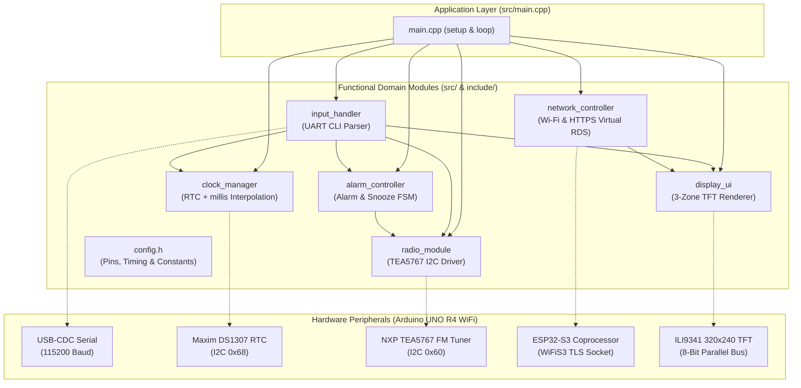
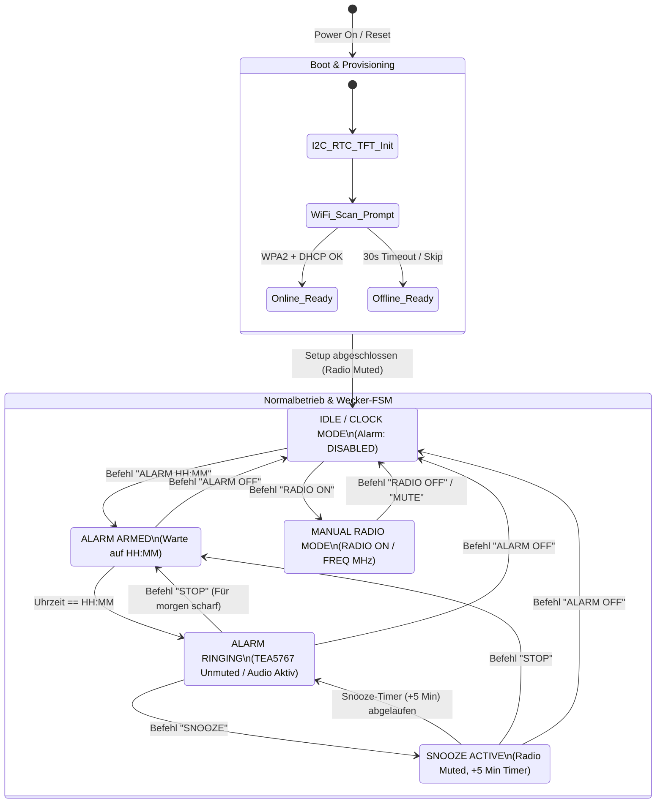

# Multifunktionaler Radiowecker

[]()
[]()
[]()
[]()
[]()
[](LICENSE)

Ein eingebettetes C++-Softwaresystem für einen **Multifunktionalen UKW-Radiowecker mit Live-Virtual-RDS** auf Basis des **Arduino UNO R4 WiFi** (Renesas RA4M1 ARM Cortex-M4 & ESP32-S3 Coprozessor). Das System kombiniert klassischen analogen UKW-Rundfunkempfang (`TEA5767`), eine batteriegepufferte Echtzeituhr (`DS1307`), ein schnelles 8-Bit-Parallel-TFT-Farbdisplay (`ILI9341`, 320×240) sowie eine cloudgestützte **Virtual-RDS-Engine**, die Live-Titelinformationen (Artist & Song) über HTTPS/JSONP abruft.

---

## Inhaltsverzeichnis / Table of Contents
1. [Überblick & Hauptfunktionen (Key Features)](#1-überblick--hauptfunktionen-key-features)
2. [Systemarchitektur & Zustandsautomat (Mermaid Diagrams)](#2-systemarchitektur--zustandsautomat-mermaid-diagrams)
3. [Hardware & Pinbelegung (Pinout Table)](#3-hardware--pinbelegung-pinout-table)
4. [Projektstruktur (Repository Structure)](#4-projektstruktur-repository-structure)
5. [Kompilieren & Flashen (Build & Flash Instructions)](#5-kompilieren--flashen-build--flash-instructions)
6. [Serielle Steuerung (CLI-Befehlsreferenz)](#6-serielle-steuerung-cli-befehlsreferenz)

---

## 1. Überblick & Hauptfunktionen (Key Features)

- **Driftfreie Echtzeituhr mit Audio-Entstörung (`ClockManager`):**
  - Kombiniert die batteriegepufferte Hardware-RTC (`Maxim DS1307`) mit einer `millis()`-basierten lokalen Delta-Interpolation.
  - Verhindert das typische sekündliche I2C-Übersprechen („Audio-Poppen“) auf den analogen Ausgang des `TEA5767`, indem der I2C-Bus nur einmal pro Stunde mit der Hardware-RTC resynchronisiert wird, während die Uhrzeit selbst bei mehrsekündigen TLS-Handshakes sekundengenau weiterläuft.
- **Zustandsbasierte Wecker- & Snooze-Steuerung (`AlarmController`):**
  - Vollständiger endlicher Zustandsautomat (`DISABLED`, `ARMED`, `RINGING`, `SNOOZED`).
  - Unterstützt tägliche Weckwiederholung, manuelles Abschalten (`STOP`), komplettes Deaktivieren (`ALARM OFF`) sowie eine **5-Minuten-Schlummerfunktion (`SNOOZE`)**.
- **UKW-Stereotuner-Treiber (`RadioTEA5767`):**
  - Direkte 5-Byte-Registerprogrammierung über I2C (`0x60`) mit gerundeter 14-Bit-High-Side-Injection-PLL-Berechnung, Frequenzbandbegrenzung (`87.5–108.0 MHz`), High-Cut-Control (`HCC`), Stereo-Noise-Cancelling (`SNC`) und Hardware-Mute.
- **Live Virtual RDS über HTTPS (`NetworkController`):**
  - Dynamischer WLAN-Scanner und interaktive WPA2-Authentifizierung beim Systemstart (mit automatischem 30s-Offline-Fallback).
  - Ruft alle 15 Sekunden über `WiFiSSLClient` (TLS 1.2/1.3 auf dem ESP32-S3) die Live-On-Air-Metadaten von **bigFM** (`core-search.radioplayer.cloud`) ab und filtert den JSONP-Stream speicherschonend mittels `ArduinoJson` v7 Filter-Projektion.
- **Flackerfreie 3-Zonen-TFT-Benutzeroberfläche (`DisplayUI`):**
  - Ansteuerung eines 320×240 Pixel `ILI9341` Displays über einen 8-Bit-Parallelbus (`Arduino_SWPAR8`).
  - Strikt getrennte Viewports für **Header-Banner** (Sender, Frequenz & Mute-Status), **Now-Playing-Bereich** (Artist & Song mit Redraw-Caching) und **Uhren-/Alarm-Footer** (flackerfreies 1-Hz-Rendering ohne Full-Rect-Löschung).
- **Nicht-blockierendes USB-Serial-CLI (`InputHandler`):**
  - Robuste Befehlseingabe im laufenden Betrieb mit strikter Eingabevalidierung und Pufferüberlaufschutz.

---

## 2. Systemarchitektur & Zustandsautomat (Mermaid Diagrams)

### 2.1 Modulare Softwarearchitektur



### 2.2 Zustandsautomat (Device & Alarm State Machine)



---

## 3. Hardware & Pinbelegung (Pinout Table)

| Component | Pin / Bus | Function | Notes |
| :--- | :--- | :--- | :--- |
| **ILI9341 TFT Display** | `A0` (`LCD_RD`) | 8-Bit Parallel Read Strobe | Active Low |
| **ILI9341 TFT Display** | `A1` (`LCD_WR`) | 8-Bit Parallel Write Strobe | Active Low |
| **ILI9341 TFT Display** | `A2` (`LCD_RS` / `DC`) | Data / Command Select | Registerauswahl |
| **ILI9341 TFT Display** | `A3` (`LCD_CS`) | Chip Select | Active Low |
| **ILI9341 TFT Display** | `D10` (`LCD_RST`) | Hardware Reset | Active Low |
| **ILI9341 TFT Display** | `D8`, `D9`, `D2`–`D7` | 8-Bit Parallel Data (`D0`–`D7`) | `Arduino_SWPAR8` Datenbus |
| **TEA5767 FM Radio** | `A4` (`SDA`), `A5` (`SCL`) | Primärer I2C-Bus (`Wire`, `0x60`) | UKW-Tuner (87.5–108.0 MHz, 3.3V/5V) |
| **DS1307 RTC Modul** | `A4` (`SDA`), `A5` (`SCL`) | Primärer I2C-Bus (`Wire`, `0x68`) | Echtzeituhr mit CR2032-Pufferbatterie |
| **ESP32-S3 Wi-Fi** | Interner UART-Bus | `WiFiS3` Netzwerk-Coprozessor | HTTPS/TLS 1.2+ für Virtual RDS |
| **Serielles Terminal** | `USB-C` (`D0`/`D1`) | `Serial` @ `115200` Baud | Zeilenumbruch auf `LF` (Newline) stellen |

---

## 4. Projektstruktur (Repository Structure)

```text
multifunktionaler-radiowecker/
├── docs/
│   ├── ARCHITECTURE.md          # Detaillierte Architektur- & Pinout-Dokumentation
│   └── CODE_AUDIT.md            # Technischer Code-Audit-Bericht & Fehleranalyse
├── include/
│   ├── alarm_controller.h       # Deklaration des Wecker- & Snooze-Zustandsautomaten
│   ├── clock_manager.h          # Deklaration der DS1307-RTC & driftfreien Zeitinterpolation
│   ├── config.h                 # Zentrale Hardware-Pins, Timing-, Netzwerk- & UI-Konstanten
│   ├── display_ui.h             # Schnittstelle für das 3-Zonen-TFT-User-Interface
│   ├── input_handler.h          # Schnittstelle für den nicht-blockierenden Serial-CLI-Parser
│   ├── network_controller.h     # Schnittstelle für WLAN-Setup & HTTPS Virtual RDS
│   └── radio_module.h           # Klassen-Interface für den TEA5767 I2C-UKW-Tuner
├── src/
│   ├── alarm_controller.cpp     # Implementierung der Alarmlogik & Snooze-Timer
│   ├── clock_manager.cpp        # Implementierung der RTC-Synchronisation & Zeitberechnung
│   ├── display_ui.cpp           # ILI9341 Grafik-Rendering über 8-Bit-Parallelbus
│   ├── input_handler.cpp        # Parser & Dispatcher für serielle Benutzerbefehle
│   ├── main.cpp                 # System-Einstiegspunkt (setup & kooperative loop)
│   ├── network_controller.cpp   # WLAN-Verbindungsaufbau & JSONP-Stream-Deserialisierung
│   └── radio_module.cpp         # TEA5767 PLL-Berechnung, I2C-Transfer & Bus-Scanner
├── legacy/
│   ├── test_tea.py              # Historisches Hilfsskript zur Registeranalyse
│   └── test_wire1.cpp           # Isolierter I2C-Test-Snippet außerhalb des Build-Baums
├── lib/                         # Projektspezifische private Bibliotheken (PlatformIO)
├── test/                        # Unit-Test-Verzeichnis (PlatformIO Test Runner)
├── .gitignore                   # Git-Ausschlussregeln für Build-Artefakte & IDE-Dateien
├── LICENSE                      # MIT Open-Source-Lizenz
├── platformio.ini               # PlatformIO Build- & Dependency-Konfiguration
└── README.md                    # Projektdokumentation
```

---

## 5. Kompilieren & Flashen (Build & Flash Instructions)

### Voraussetzungen
- [Visual Studio Code](https://code.visualstudio.com/) mit der [PlatformIO IDE Extension](https://platformio.org/install/ide?install=vscode) **oder** PlatformIO Core CLI (`pio`).
- **Arduino UNO R4 WiFi** per USB-C-Kabel mit dem PC verbunden.

### Schritt-für-Schritt-Anleitung

1. **Repository klonen:**
   ```bash
   git clone https://github.com/xRyuks/multifunktionaler-radiowecker.git
   cd multifunktionaler-radiowecker
   ```

2. **Abhängigkeiten installieren & Firmware kompilieren:**
   PlatformIO lädt die in `platformio.ini` definierten Bibliotheken (`ArduinoJson`, `Arduino_GFX`, `RTClib`) sowie die `renesas-ra` Toolchain automatisch herunter:
   ```bash
   pio run
   ```

3. **Firmware auf den Arduino UNO R4 WiFi flashen:**
   ```bash
   pio run --target upload
   ```

4. **Seriellen Monitor öffnen (`115200` Baud):**
   ```bash
   pio device monitor -b 115200
   ```
   > **Hinweis:** Beim ersten Start scannt der Radiowecker nach verfügbaren WLAN-Netzwerken. Wähle die Nummer deines Netzwerks im Seriellen Monitor aus und gib das WPA2-Passwort ein (oder warte 30 Sekunden für den automatischen Start im Offline-Modus).

---

## 6. Serielle Steuerung (CLI-Befehlsreferenz)

Stelle sicher, dass der Serielle Monitor auf **`115200` Baud** und Zeilenende **`Newline (LF)`** oder **`Both NL & CR`** eingestellt ist:

| Befehl | Beispiel | Beschreibung |
| :--- | :--- | :--- |
| `ALARM HH:MM` | `ALARM 07:30` | Setzt und aktiviert die tägliche Weckzeit im 24-Stunden-Format. |
| `ALARM OFF` | `ALARM OFF` | Deaktiviert den Wecker vollständig und schaltet das Radio sofort stumm. |
| `STOP` | `STOP` | Schaltet den aktuell klingelnden Alarm stumm (Wecker bleibt für den Folgetag aktiv). |
| `SNOOZE` | `SNOOZE` | Schaltet das Radio stumm und weckt erneut nach **5 Minuten**. |
| `SET TIME HH:MM:SS` | `SET TIME 14:30:00` | Stellt die aktuelle Uhrzeit (Software-Uhr & DS1307 Hardware-RTC). |
| `RADIO ON` | `RADIO ON` | Schaltet den UKW-Tuner manuell laut (Unmute). |
| `RADIO OFF` | `RADIO OFF` | Schaltet den UKW-Tuner manuell stumm (Mute). |
| `FREQ <MHz>` | `FREQ 105.2` | Stellt die Empfangsfrequenz im Bereich `87.5` bis `108.0 MHz` ein. |
| `HELP` | `HELP` | Gibt eine Übersicht aller Befehle im Seriellen Monitor aus. |

---

## Lizenz (License)
Dieses Projekt ist unter der **MIT-Lizenz** lizenziert – siehe [LICENSE](LICENSE) für weitere Details.
